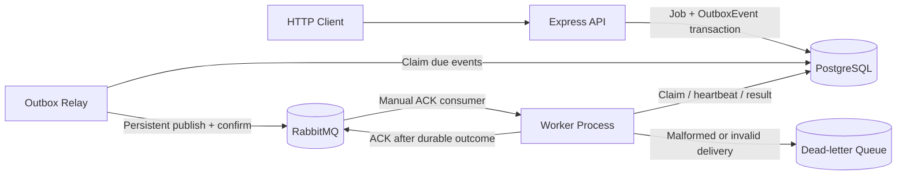
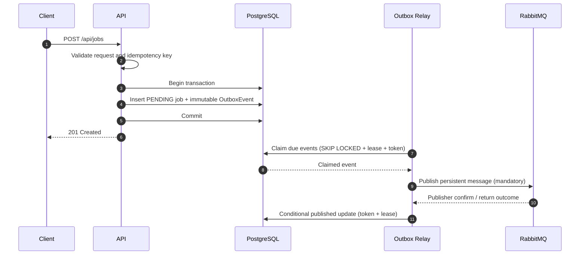
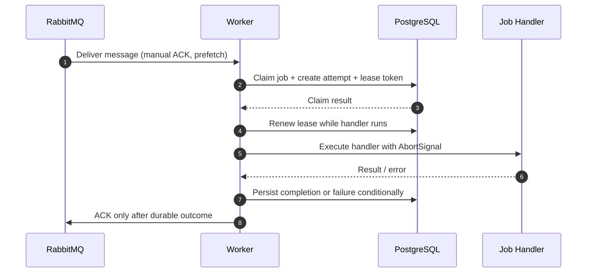

# FlowForge Architecture

FlowForge is a distributed background-job processing system built around PostgreSQL and RabbitMQ. The API, Outbox Relay, and Worker run as independent processes so request handling, message publication, and job execution can scale and recover separately.

## System overview

### Runtime components

| Component | Responsibility | Dependency |
|---|---|---|
| API | Validates job submissions, applies idempotency behavior, and commits a job with its outbox event atomically | PostgreSQL |
| PostgreSQL | System of record for jobs, attempts, outbox events, publication leases, and worker execution leases | — |
| Outbox Relay | Claims due outbox events, publishes persistent messages, waits for broker confirms, and records publication | PostgreSQL, RabbitMQ |
| RabbitMQ | Durable job transport and dead-letter routing | — |
| Worker | Consumes deliveries, claims jobs using database leases, executes handlers, persists outcomes, and ACKs | PostgreSQL, RabbitMQ |

The API can start and accept submissions while RabbitMQ is unavailable; the relay retries publication when the broker becomes available. The relay and worker are separate runnable processes (`npm run relay` and `npm run worker`).

## Job submission and transactional outbox

The API writes the job and its immutable `job.submitted` outbox event in one PostgreSQL transaction. This prevents a committed job from being separated from the durable record that requests publication.

The relay claims due unpublished events in short transactions using `FOR UPDATE SKIP LOCKED`, a per-event lock token, and a lease. It commits the claim before publishing. Messages are persistent and carry the stable OutboxEvent ID as RabbitMQ `messageId`; publication uses mandatory routing and publisher confirms. The relay marks an event published only after a positive confirm and no unroutable return, using a conditional update that verifies ownership.

### Delivery guarantee and duplicate publication

The outbox provides **at-least-once publication**, not exactly-once delivery or execution. If RabbitMQ confirms a message and the relay crashes before persisting `publishedAt`, the lease eventually expires and the event can be published again. Consumers must therefore tolerate duplicate deliveries.

The worker's database lease and fencing token protect job state from stale workers, but they cannot make arbitrary external side effects exactly-once. Any retryable handler that calls an external system must use that system's idempotency mechanism or another explicit deduplication strategy.

## Worker execution and recovery

- Workers use manual acknowledgements and configurable prefetch (default `1`).
- A worker claims a job transactionally and records an execution attempt, lease, and unique fencing token.
- The worker renews its lease while the handler runs. An expired lease can be reclaimed.
- Completion and terminal failure are persisted before the delivery is ACKed.
- Ordinary handler errors are retried with capped exponential backoff until `maxAttempts`; terminal business/validation errors can use `TerminalJobError`.
- Lease-expired claims count toward `maxAttempts`. Exhausted jobs become `FAILED`.
- Duplicate deliveries wait for the active lease owner rather than being discarded.
- Malformed JSON and schema-invalid messages are routed to the durable dead-letter queue. The worker waits for the DLQ publisher confirm before ACKing the original delivery; if routing or confirmation fails, it requeues the original delivery.

### Retry and acknowledgement boundaries

There are two separate retry paths:

1. **Publication retries:** the relay retains unpublished outbox rows, clears failed claims, records a safe error, and advances `availableAt` using capped exponential backoff. There is no fixed maximum publication-attempt count.
2. **Handler retries:** the worker persists job/attempt state and schedules retry using `JOB_RETRY_BASE_DELAY_MS` and `JOB_RETRY_MAX_DELAY_MS`, subject to `maxAttempts`.

Broker delivery failures (for example, a database error while processing a delivery) are distinct from a handler's persisted retry state. The worker delays and requeues those deliveries rather than treating them as successful job execution.

## Reliability and operational behavior

- **Broker reconnect:** worker and relay detect channel/connection loss, retire the old generation, reconnect with bounded exponential backoff and jitter, redeclare topology, and resume consuming or claiming.
- **Relay crash recovery:** abandoned outbox claims become eligible after `lockedUntil` expires.
- **Worker crash recovery:** unacknowledged messages are returned by RabbitMQ when the channel closes; another worker can claim the job after the execution lease expires.
- **Graceful shutdown:** the relay stops polling and drains in-flight publishes through confirm/timeout; the worker cancels its consumer, allows in-flight database-backed work through its grace period, then aborts remaining handlers. Unfinished deliveries are not ACKed.
- **Readiness and operations:** API, worker, and relay expose health/readiness and operational endpoints. Operational responses include pending outbox count, oldest unpublished event age, and failed-job count without exposing credentials or connection strings.

Fencing prevents stale workers from committing stale database outcomes. It does **not** stop a handler that ignores its AbortSignal from continuing an external side effect after shutdown; handlers must account for that possibility.

## Testing strategy

The repository contains unit/HTTP tests and a separate real-service integration environment:

- Integration tests use a dedicated PostgreSQL database (`flowforge_integration`) and RabbitMQ instance with isolated Compose project names and loopback-only ports.
- The integration runner validates its dedicated environment before running migrations or tests; it does not use the development `DATABASE_URL`.
- Process-level tests exercise worker/relay recovery, broker service recreation, and graceful shutdown.
- CI runs formatting, lint, Prisma validation, production/test TypeScript checks, unit tests, production build, and the isolated PostgreSQL/RabbitMQ integration suite.

See the [README](../README.md) for setup commands, environment variables, scripts, and the local crash-recovery walkthrough.

## Explicit scope and limitations

- The worker currently supports the deterministic `demo` job type; the development/test-only `crash-test` handler is unavailable in production.
- Exactly-once execution is not claimed. External side effects require idempotency at the handler/integration boundary.
- The outbox migration does not backfill legacy jobs.
- Published outbox events are retained; automatic archival/deletion is not implemented.
- Redis, Kafka, Kubernetes, scheduled jobs, Prometheus, and Grafana are not part of the current implementation.
